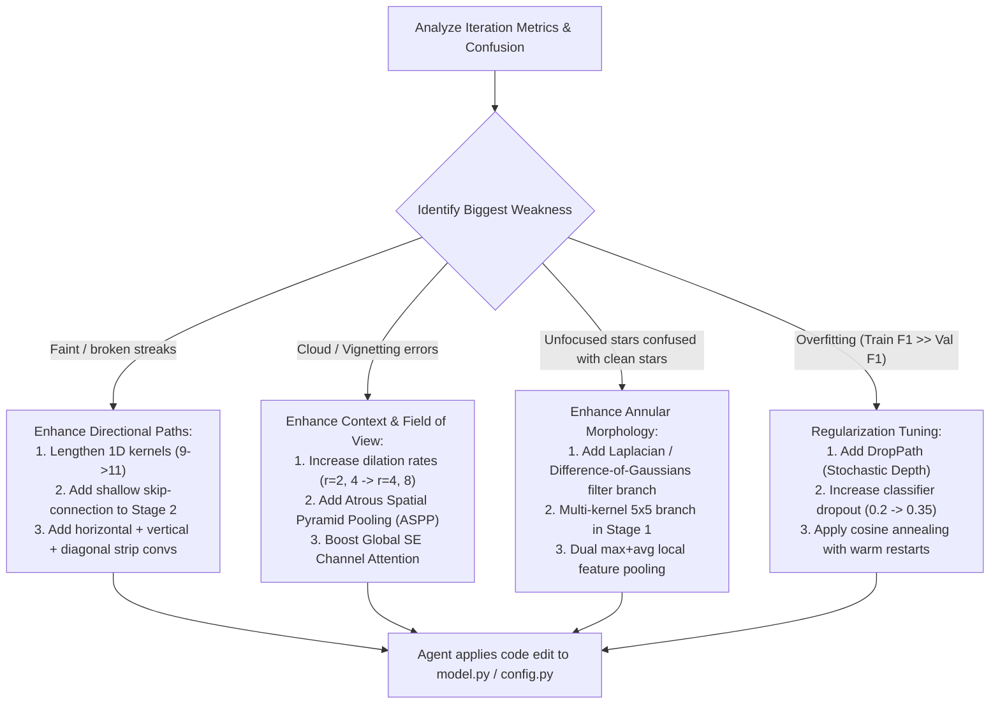

# AI Agent-in-the-Loop Custom CNN Evolutionary Training Specification

> **User Command**: *"Agent, run this loop for N iterations!"*
>
> **Core Concept**: The AI agent (Antigravity / Claude Code / agy) acts as the **active neural architect and researcher**. Instead of a fixed hardcoded genetic algorithm, the AI agent inspects code, trains the custom CNN, reviews loss curves and class F1 metrics, modifies the PyTorch architecture and hyperparameters directly in code, logs structured reflections, and repeats for $N$ iterations until reaching peak performance.

---

## 1. High-Level Concept: The AI Agent as Neural Architect

Traditional AutoML / Hyperopt treats models as black-box hyperparameter tuples. In this pipeline, **the AI Agent operates directly on the PyTorch source code**:

```
                                USER PROMPT:
                "Agent, run the auto-cnn loop for 20 iterations"
                                     │
                                     ▼
 ┌────────────────────────────────────────────────────────────────────────┐
 │                     AI AGENT INVOCATION CYCLE                          │
 │                                                                        │
 │  ┌──────────────────────────────────────────────────────────────────┐  │
 │  │ 1. INSPECT & PREPARE                                             │  │
 │  │    Read `experiments/leaderboard.md` and current architecture.   │  │
 │  │    Formulate testable astronomical hypothesis.                   │  │
 │  └──────────────────────────────┬───────────────────────────────────┘  │
 │                                 │                                      │
 │                                 ▼                                      │
 │  ┌──────────────────────────────────────────────────────────────────┐  │
 │  │ 2. TRAIN & EVALUATE (Via CLI Tool)                               │  │
 │  │    Run: python -m auto_cnn.runner --iter <i> --epochs 20         │  │
 │  │    Captures training curves, per-class F1, params, and speed.    │  │
 │  └──────────────────────────────┬───────────────────────────────────┘  │
 │                                 │                                      │
 │                                 ▼                                      │
 │  ┌──────────────────────────────────────────────────────────────────┐  │
 │  │ 3. ANALYZE RESULTS & LOG ITERATION                               │  │
 │  │    Parse `experiments/run_<i>.json`. Compare vs Champion.        │  │
 │  │    Write reflection to `experiments/architect_log.md`:           │  │
 │  │    - What was changed? Why?                                      │  │
 │  │    - What was the resulting F1 delta per class?                  │  │
 │  │    - Keep or Rollback?                                           │  │
 │  └──────────────────────────────┬───────────────────────────────────┘  │
 │                                 │                                      │
 │                                 ▼                                      │
 │  ┌──────────────────────────────────────────────────────────────────┐  │
 │  │ 4. MUTATE ARCHITECTURE (Direct Code Edits via Tool)              │  │
 │  │    Agent edits `auto_cnn/model.py` or `auto_cnn/config.py`:      │  │
 │  │    - e.g., low streak F1 -> add asymmetric convs / skip layers.  │  │
 │  │    - e.g., low cloud F1  -> add dilated context / SE attention.  │  │
 │  │    - e.g., low unfocused star F1 -> add annular difference filter│  │
 │  └──────────────────────────────┬───────────────────────────────────┘  │
 │                                 │                                      │
 │                                 ▼                                      │
 │  ┌──────────────────────────────────────────────────────────────────┐  │
 │  │ 5. REPEAT (Loop i = 1 ... N)                                     │  │
 │  │    Next iteration until N target iterations reached!             │  │
 │  └──────────────────────────────────────────────────────────────────┘  │
 └────────────────────────────────────────────────────────────────────────┘
```

---

## 2. Astronomical Physics: Custom CNN Architecture ("NovaNet")

### Strict Rules:
- **NO AstroNet** (AstroNet is an existing ResNet clone; we design our own novel structure).
- **NO Pre-trained models** (no torchvision ResNet, MobileNet, EfficientNet).
- **Unified 3-Channel `float32` Contract**: Input shape `[B, 3, 512, 512]` (Median Subtracted, ZScale Stretched, High-Pass Residual).
- **6 Multi-Label Targets**:
  `[0: satellite_streak, 1: airplane, 2: cloud, 3: obstruction, 4: star_trail, 5: unfocused_stars]`

### NovaNet Architectural Blueprint:
```
                          Input: [B, 3, 512, 512] (float32)
                                       │
                ┌──────────────────────┴──────────────────────┐
                │                                             │
      High-Res Linear Stem                          Diffuse Context Stem
   [Conv 1x7 + Conv 7x1, s=1]                     [Conv 5x5, s=2, MaxPool 2x2]
      Linear streaks & trails                       Nebulae, clouds, haze
           C=24, 512x512                                  C=24, 128x128
                │                                             │
                │ (Stride 2 downsample)                       │ (Bilinear match)
                └──────────────────────┬──────────────────────┘
                                       │
                        Stem Fusion Block (GN + GELU)
                                 C=48, 256x256
                                       │
                     Stage 1: Multi-Scale Directional Block
                        [1x1 -> (3x3 || 1x7+7x1 || 3x3_d2) -> SE]
                                 C=64, 128x128
                                       │
                     Stage 2: Multi-Scale Directional Block
                        [1x1 -> (3x3 || 1x7+7x1 || 3x3_d4) -> SE]
                                 C=128, 64x64
                                       │
                     Stage 3: Deep Context & Annular Block
                        [1x1 -> (3x3 || Dilated 3x3_d4) -> SE]
                                 C=192, 32x32
                                       │
                     Stage 4: Semantic Classification Stage
                                 C=256, 16x16
                                       │
                     Dual Global Pooling (AvgPool + MaxPool)
                       Area features + Sparse streak peaks
                                   Dim: 512
                                       │
                     Classification Head (Linear -> Dropout -> Linear)
                                       │
                       Output Logits [B, 6] (Sigmoids)
```

---

## 3. The 5-Step AI Agent Loop Protocol

When the user runs:
> **"Agent, please optimize the custom CNN for 10 iterations"**

The AI Agent follows this rigorous sequence for every iteration $i \in \{1 \dots N\}$:

### Step 1: Train Network
The agent runs the training command:
```bash
python -m auto_cnn.runner train \
  --iter $i \
  --epochs 20 \
  --batch-size 16 \
  --device cuda \
  --out-dir experiments
```
The runner:
- Loads the current `NovaNet` defined in `training/auto_cnn/model.py`.
- Trains with multi-label positive-weighted BCE loss, AdamW, and Cosine Annealing.
- Evaluates validation metrics every epoch and keeps the epoch with best Macro F1.
- Saves weights to `experiments/checkpoints/iter_${i}_best.pt`.
- Outputs a standardized JSON report to `experiments/run_${i}.json`.

### Step 2: Test Network & Evaluate Metrics
The agent parses `experiments/run_${i}.json` and extracts:
- **`val_macro_f1`**: Overall multi-label F1 across all 6 classes.
- **Per-class F1**:
  - Streak sensitivity: $F1_{\text{satellite\_streak}}$, $F1_{\text{airplane}}$
  - Area haze sensitivity: $F1_{\text{cloud}}$, $F1_{\text{obstruction}}$
  - PSF blur sensitivity: $F1_{\text{unfocused\_stars}}$, $F1_{\text{star\_trail}}$
- **Clean Sky Specificity**: True Negative rate when no defects are present.
- **Efficiency**: Model parameters ($M$) and average inference latency ($ms$).

### Step 3: Log Structure, Best Model & Architect Reflections
The agent updates two persistent ledgers:
1. **`experiments/leaderboard.md`**:
   | Rank | Iter | Model Description | Macro F1 | Satellite F1 | Cloud F1 | Unfocused F1 | Clean Acc | Params | Status |
   | :---: | :---: | :--- | :---: | :---: | :---: | :---: | :---: | :---: | :---: |
   | 🥇 1 | 3 | NovaNet-v3 (Asymmetric 9x1 stem + SE) | **0.894** | 0.942 | 0.890 | 0.881 | 96.8% | 3.8M | Champion |
   | 🥈 2 | 1 | NovaNet-v1 (Baseline dual stem) | 0.852 | 0.891 | 0.865 | 0.840 | 94.2% | 3.2M | Baseline |
   | ❌ - | 2 | NovaNet-v2 (Deep stage 5) | 0.831 | 0.870 | 0.842 | 0.820 | 92.5% | 6.1M | Reverted |

2. **`experiments/architect_log.md`**:
   The agent writes a concise research entry:
   ```markdown
   ## Iteration 3 Summary
   - **Hypothesis**: Expanding asymmetric strip kernel length from 7 to 9 in the linear stem will capture longer streak continuity without losing resolution.
   - **Code Changes**: Modified `model.py:LinearStem` kernel to `(1, 9)` and `(9, 1)`. Added SE attention reduction ratio 16.
   - **Outcome**: Macro F1 improved from 0.852 to 0.894 (+0.042). Satellite streak F1 increased +0.051.
   - **Decision**: ACCEPTED as new Champion. Checkpoint promoted to `experiments/champion.pt`.
   ```

### Step 4: Reason & Propose Architecture Improvement
The AI Agent evaluates the remaining errors and reasons about physical domain improvements. It then **directly modifies `auto_cnn/model.py` or `auto_cnn/config.py` using its code editing tools**:



### Step 5: Repeat Loop (Until Iteration $N$)
- If the current iteration improved over the champion, update `champion.pt` and proceed with the new structure.
- If the current iteration severely degraded accuracy ($>0.02$ drop), the agent **reverts the code change** using git or backup copy, logs why it failed, and tries a different architectural hypothesis.
- When iteration $N$ is reached, the agent stops, exports the champion model to ONNX, and presents the final evolutionary progression report to the user.

---

## 4. File Layout & Code Implementation Plan

```
training/
├── auto_cnn/
│   ├── __init__.py
│   ├── config.py              # Tunable hyperparameter & architectural dataclasses
│   ├── model.py               # The editable NovaNet PyTorch model (Agent edits this!)
│   ├── dataset.py            # Fast float32 [3, 512, 512] patch loader
│   ├── runner.py              # CLI trainer & evaluator: runs 1 iteration and writes run_<i>.json
│   └── tracker.py             # Maintains experiments/leaderboard.md and architect_log.md
├── experiments/
│   ├── champion.pt            # Best model weights across all iterations
│   ├── champion.onnx          # Final exported ONNX
│   ├── leaderboard.md         # Ranked table of all iterations
│   ├── architect_log.md       # AI Agent notes and hypothesis progression
│   ├── checkpoints/           # Checkpoints for each iteration
│   └── run_*.json             # Machine-readable per-iteration stats
├── AUTO_CNN_ITER.md           # This specification document
```

---

## 5. Agent Instructions: How the AI Executes the Loop

When the user asks you (the Agent) to run $N$ iterations:

1. **Check Workspace & Baseline**:
   - Ensure `training/prep_dataset.py` has generated `train_manifest.json` and `val_manifest.json`.
   - Inspect `experiments/leaderboard.md` to see current iteration index. If starting fresh, begin at `i = 1`.
2. **Execute Iteration $i$**:
   - Run the trainer CLI:
     ```bash
     /home/patrick115/Projects/MasterThesis/training/env/bin/python -m training.auto_cnn.runner train --iter $i --epochs 20 --device cuda
     ```
3. **Inspect Output**:
   - Read `training/experiments/run_${i}.json`.
4. **Log Reflection**:
   - Append analysis to `training/experiments/architect_log.md` and update `leaderboard.md`.
5. **Architectural Mutation**:
   - Reason about the weakest class.
   - Use `replace_file_content` to mutate `training/auto_cnn/model.py` or `config.py`.
6. **Repeat**:
   - Increment $i \gets i + 1$.
   - Continue until $i = N$.
7. **Final Summary**:
   - Export best model to ONNX via `python -m training.auto_cnn.runner export`.
   - Present summary table and evolutionary gains to the user.
